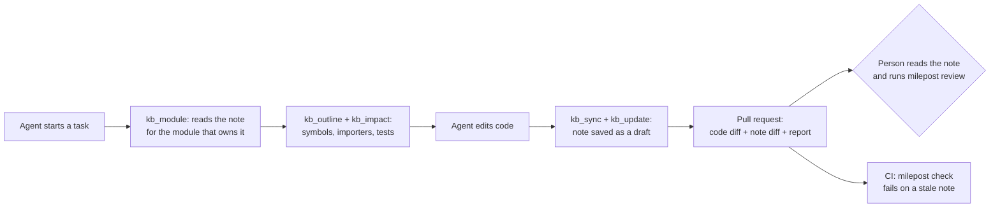

# Milepost

**Reviewed, drift-checked notes about your code, kept in git, for coding agents and the people who supervise them.**

[](https://github.com/vibhu-athavaria/milepost/actions/workflows/ci.yml)
Apache-2.0 · Python 3.12 · Claude Code plugin · MCP server

> **Status: MVP, unproven.** It works end to end as a Claude Code plugin loaded from a local checkout. It is not on PyPI, it has not been run on a real team, and nobody has measured the central claims yet (see [What is proven](#what-is-proven-and-what-is-not)). Treat it as something to try, not something to depend on.

---

## Why

Coding agents learn your repository by searching it, every session, from zero. They open files to find the right file, miss the one that owns a behavior because it doesn't share a keyword, and forget what they worked out the moment the session ends.

At the same time they change more code than any one person reads. A mistake an agent makes can pass through review because nobody had the context to spot it.

Milepost gives both problems the same answer: **a small set of short notes per module, living in your repository, that go stale loudly instead of quietly.**

| For the agent | For the people |
|---|---|
| Finds the right module, the exact symbols to read, who imports a file and which tests cover it, in a few small calls instead of a repository-wide search | Sees in the pull request what changed in each module, which notes no person has reviewed, and which changed code the notes call risky |
| Writes back what it learned, so the next session and the next teammate start ahead | Gets a mechanical alarm when code changes and its note does not |

## Quick start (about five minutes)

You need [uv](https://docs.astral.sh/uv/) and [Claude Code](https://claude.com/claude-code).

1. **Get milepost and put the `milepost` command on your PATH.**
   ```bash
   git clone <this repository> && cd milepost
   uv sync --python 3.12 && uv tool install --editable .
   ```
2. **Open the repository you want to try it on** and start Claude Code with the plugin loaded:
   ```bash
   cd /path/to/your/repo
   claude --plugin-dir /path/to/milepost/plugin
   ```
3. **Run `/milepost:kb-init`.** It checks your setup, lists candidate modules, shows exactly which files would be sent to a model and the token estimate, and asks **once**. No API key? It offers *agent mode*, where Claude Code itself writes the notes.
4. **Read the drafts** under `kb/modules/`, fix anything wrong, and approve each with `milepost review module/<id>`. Then commit `milepost.toml`, `kb/`, `.gitattributes` and `.github/workflows/milepost.yml`.
5. **Work as usual.** The agent is shown the module index at session start, is told which notes cover each file it edits, and is stopped once if it finishes with a note out of date.

Full steps, what to expect on a first run, and troubleshooting are in **[USAGE.md](USAGE.md)**.

## How it works



*In words: the agent reads a short note before touching code, edits, updates the note, and the note change travels through your normal pull request, where a person reviews it and CI checks it is current.*

Four ideas carry the design:

**1. Notes are plain markdown in git.** One file per module: purpose, entry points, a file map, owned data, the rules that must hold, and the traps. They are reviewed, diffed and merged like code. There is no service to run. The search index is a local cache you can delete.

**2. Notes know when their code moved on.** A note names the source files it covers. `milepost check` asks git: did a covered file change after the note was last touched? If so the note is *stale*. By default that is a warning; set `[check] stale = "fail"` and a pull request that edits covered code without touching its note fails (unless someone records a reason). Nothing is stored in the note, so there is no hash to conflict.

**3. Only what code can't tell you is written down.** A note holds purpose, contracts, rules and gotchas. Anything that can be worked out from the code is computed when asked and never stored, so it can't rot:

| Asked | Computed from the code, now |
|---|---|
| What is in this file? | `milepost outline`: symbols, signatures, line ranges |
| Who depends on this file, and which tests cover it? | `milepost impact`: importers and likely tests |
| What do I need to update after this change? | `milepost sync`: the notes to touch, and how |

**4. Agents can write, but only a person can approve.** Every agent edit saves a note as `draft`. Only `milepost review`, run by a person, marks it `reviewed` and records who and when. The flip from `reviewed` to `draft` shows in the pull request diff, so an agent can't quietly change what a reviewer signed off.

<details>
<summary><b>Exactly how staleness is judged</b></summary>

Per module, using only git:

1. If the note has uncommitted edits, it is fresh (someone just touched it).
2. Otherwise, if a covered file has uncommitted changes, it is stale.
3. Otherwise it is stale unless the latest commit touching a covered file is the same as, or an ancestor of, the latest commit touching the note.

This is an approximation of "the note was written against this code": it cannot tell whether the author read the new code. Re-saving a note unchanged counts as touching it. Review is what vouches for the prose. In a pull request the rule is simpler: it edits covered code and does not touch the note.
</details>

## What a note looks like

```markdown
---
kb_schema: 1
id: module/ai
title: AI tutoring
status: reviewed                     # draft until a person signs off
sources:
  - backend/app/ai/**/*.py           # the files this note describes
related: [services, core]
written_by: agent
written_at: 2026-10-07T09:12:00Z
reviewed_by: Jane Doe <jane@example.com>   # set only by `milepost review`
reviewed_at: 2026-10-08T14:00:00Z
---

## Purpose
Generates hints and explanations for students and decides when to escalate to a teacher.

## Entry points
- `backend/app/ai/tutor.py::answer_question`: called by the chat route.

## File map
- `tutor.py`: answers questions and decides when to escalate.
- `client.py`: the only place a model provider is called.

## Invariants
- Every model call goes through `client.py`; no route calls a provider directly.

## Gotchas
- Hints are cached for ten minutes. The cache key includes the student's last answer: `cache.py`.
```

Files and symbols cited in backticks are checked: `milepost check` warns when a note cites something that isn't there, which catches the most common way a model-written note goes wrong.

## What you get

| Capability | State |
|---|---|
| Notes as markdown in git, one per module, with staleness judged from git history | Works |
| `check` and a CI gate: a pull request that edits covered code without touching its note is flagged (a warning by default, a failure if you choose); waivers need a written reason | Works |
| A merge driver for notes: bodies merge line by line, and a merge that mixes in other people's prose returns a reviewed note to `draft` | Works |
| MCP server with ten `kb_*` tools; each response says what to do next | Works |
| Claude Code plugin: `/milepost:kb-init`, a usage skill, and hooks (index at session start, covering notes after each edit, one stop if a note is stale) | Works, loaded from a local checkout |
| Computed context: `outline`, `impact`, `sync` | Works (Python, TypeScript, JavaScript) |
| Local hybrid search over the notes (keyword + meaning, no API key) | Works |
| Drafting with your own model (OpenRouter, Anthropic, anything LiteLLM supports) or with Claude Code itself (agent mode, no key) | Works |
| Human visibility: `status` (unreviewed change per module), `report` (a pull-request aid, in the CI job summary), a churn warning, a `CODEOWNERS` template | Works |
| Safe handling of your code: secret scan, exclusion list, a dry run that lists every file before anything is sent | Works |
| Install from a marketplace or PyPI | Not yet. Needs a release |
| Other agents (Cursor, Codex and so on) | Untested. The server is standard MCP, and an `AGENTS.md` snippet carries the playbook |

## What is proven, and what is not

Proven: the pieces do what they say. The test suite passes on Linux and macOS in CI, including a real MCP client talking to the server and real git merges.

**Not proven, and the reason this is an MVP:**

- That agents using the notes read fewer files and spend fewer tokens. A pilot protocol is in [PILOT.md](PILOT.md); no results exist yet.
- That reviewers keep a better grip on agent-written code. Same.
- That the plugin behaves in a live Claude Code session. Its pieces are tested; the whole has not been run by a person yet.
- That it is worth it for small repositories. A good `CLAUDE.md` captures much of the benefit under a few hundred files.
- That it runs on Windows. Only Linux and macOS are tested.

## What it does not do

- **It doesn't understand your code.** It lists symbols, follows imports statically, and nothing deeper. `impact` misses dynamic imports and framework wiring.
- **It doesn't find bugs.** It shows people where to look. A wrong change still needs review and tests.
- **It can't prove a note is true.** Git can say a note is older than the code; only a person reading it vouches for the content. If reviewers rubber-stamp, the `reviewed` badge means nothing.
- **It can't see drift outside a note's file set**, and any commit that touches a covered file after the note makes it stale, however small. That is friction, which is why a stale note only warns unless you opt in to failing.
- **"Touched" is not "checked".** Because staleness comes from git, re-saving a note counts as updating it. An agent can silence the warning without reading the code; the read-receipt on `kb_update` and human review are the only defences.
- **In agent mode the exclusion list and secret scan protect only what milepost hands the agent.** The agent can read any file with its own tools.

## How it is different

Several projects give agents better context. They differ in *where the knowledge lives* and *whether anything notices when it goes stale*. This table is based on each project's public description, checked in October 2026; where a page doesn't say, the cell says "not stated". Projects change, so check the source.

| Approach | What the agent gets | Where knowledge lives | Notices notes drifting from code? | Source |
|---|---|---|---|---|
| Hand-written `CLAUDE.md` / `AGENTS.md` | Whatever a person wrote | A file in the repo | No | n/a |
| **codebase-memory-mcp** | A queryable graph of code structure (17 MCP tools, including architecture decision records) | A local SQLite database; an optional compressed snapshot can be committed | N/A for the graph (re-derived). ADR staleness: not stated | [repo](https://github.com/DeusData/codebase-memory-mcp) |
| **CodeSeeker** | Hybrid search (keyword, vector, graph) over the codebase | A local `.codeseeker/` index | N/A (derived index) | [listing](https://mcpservers.org/servers/jghiringhelli/codeseeker) |
| **Serena** | IDE-like symbol retrieval and editing through language servers; also a memory system | Memories: storage and staleness handling not stated on its main page | Not stated | [repo](https://github.com/oraios/serena) |
| **Aider repo map** | A compact map of the most relevant symbols, rebuilt per request | Nothing stored | N/A (rebuilt every time) | [docs](https://aider.chat/docs/repomap.html) |
| **Basic Memory** | General-purpose notes any assistant can read and write | Markdown on disk, with a database index | Not stated; not specific to source code | [repo](https://github.com/basicmachines-co/basic-memory) |
| **ByteRover / Cipher** | A persistent, hierarchical "context tree" shared across agents and teammates | A tree with its own git-style versioning, optional cloud sync | Not stated | [docs](https://docs.byterover.dev/cipher/overview) |
| **Milepost** | Reviewed prose notes about *why* modules work as they do, plus computed outlines and impact | Markdown in your own git repo | **Yes**: staleness judged from git history, a check, an optional CI gate | this repo |

Code-graph and retrieval tools tell an agent *what the code is*. Milepost's niche is the layer they don't claim to cover: the prose a team wants to keep ("this module owns these tables", "never call this before that"), plus a mechanism that stops that prose from quietly rotting. It is meant to sit **alongside** a code-graph tool, not replace one.

## FAQ

<details>
<summary><b>Does it send my code to a model?</b></summary>

Only when notes are drafted, and only to the model you configure, or, in agent mode, to your own coding agent. `milepost init --dry-run` lists every file and the token estimate first. Checking, indexing and searching run entirely on your machine. Model names and keys come from environment variables or a git-ignored `.env`, never from committed files.
</details>

<details>
<summary><b>What does it cost?</b></summary>

Drafting is roughly one model call per module, plus the cost of reading its source (the dry run shows the estimate). After that, each task adds the cost of the tool calls and of rewriting the notes it changes. Whether that is less than the searching it saves is exactly what the pilot is meant to measure.
</details>

<details>
<summary><b>Does it replace <code>CLAUDE.md</code>?</b></summary>

No. `CLAUDE.md` is the place for rules that apply everywhere. Milepost holds per-module knowledge and tells you when it has gone out of date. The plugin delivers its own rules through its skill, so you don't paste anything into `CLAUDE.md`.
</details>

<details>
<summary><b>What if a note is wrong?</b></summary>

Correct it in a pull request, like documentation. Agents are told to treat `draft` notes as unverified and to read the source before trusting a claim that matters. `check` catches notes that cite things that don't exist; it can't catch a plausible falsehood.
</details>

<details>
<summary><b>Why git and markdown instead of a database?</b></summary>

So the knowledge is reviewed, diffable, attributable and mergeable with tools you already use, and can't be lost with a service. The database is only a cache for search.
</details>

<details>
<summary><b>Why "milepost"?</b></summary>

A milepost is a fixed marker along a route that tells you where you are and how far you have come. Each note marks a point in the code and tells you whether you are still where it was written.
</details>

## Roadmap

Built test-first. Details and the named tests for each milestone are in [TASKS.md](TASKS.md).

| Milestone | State |
|---|---|
| Notes, config, structure scanners, `check` and the CI gate | Done |
| Local search; drafting, `init`, `doctor`, `.env`; review, git hooks, merge driver | Done |
| Computed context (`outline`, `impact`, `sync`); human-visibility views; agent-mode drafting | Done |
| MCP server (ten tools) and the Claude Code plugin | Done; live-session test is next |
| Pilot: token cost, review effort, and the release decision | **Next.** Needs the pass rule agreed |
| Publish to PyPI; plugin marketplace entry; a working generated CI workflow | After the pilot |

## Documents

| File | What it is |
|---|---|
| [USAGE.md](USAGE.md) | Trying the plugin, day to day, every command, configuration, troubleshooting |
| [SPEC.md](SPEC.md) | What is built: every file format, command, staleness rule and tool contract |
| [PROPOSAL.md](PROPOSAL.md) | Why the project exists and the alternatives considered |
| [TASKS.md](TASKS.md) | The build order, with named tests per milestone |
| [PILOT.md](PILOT.md) | How to measure whether it helps |
| [plugin/](plugin/) | The Claude Code plugin |
| [templates/](templates/) | Config example, note skeleton, `.env`, CLAUDE.md, AGENTS.md and CODEOWNERS snippets |

## Development

Requires Python 3.12 and [uv](https://docs.astral.sh/uv/).

```bash
uv sync --python 3.12
uv run pytest            # unit and integration tests
uv run ruff check        # lint
uv run mypy              # strict type check
```

Tests are written before the code, and a milestone counts as done only when its acceptance commands have been run. On Intel Macs, `pyproject.toml` constrains the resolver so a version of `onnxruntime` with a macOS x86_64 build is chosen.

## Naming and license

Developed under the working name `kbmap`, which was taken on PyPI by an unrelated project, so it is now **Milepost**. Other unrelated projects share the name; this one is none of them. Apache-2.0, see [LICENSE](LICENSE).
